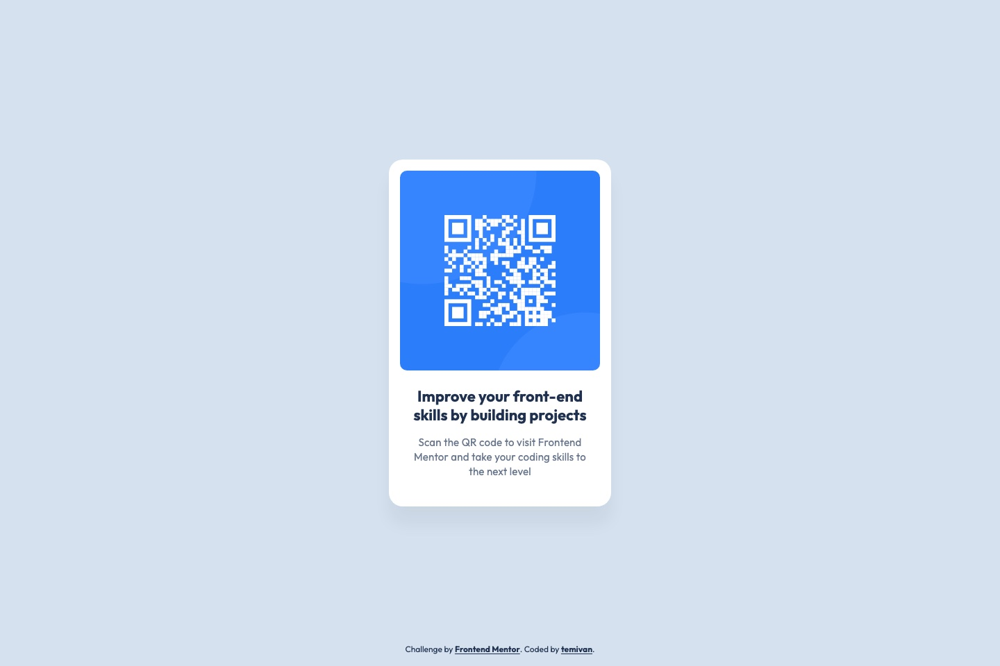

# Frontend Mentor - QR code component solution

This is a solution to the [QR code component challenge on Frontend Mentor](https://www.frontendmentor.io/challenges/qr-code-component-iux_sIO_H). Frontend Mentor challenges help you improve your coding skills by building realistic projects.

## Table of contents

- [Overview](#overview)
  - [Screenshot](#screenshot)
  - [Links](#links)
- [My process](#my-process)
  - [Built with](#built-with)
  - [What I learned](#what-i-learned)
  - [Continued development](#continued-development)
  - [Useful resources](#useful-resources)
  - [AI Collaboration](#ai-collaboration)
- [Author](#author)

## Overview

### Screenshot



### Links

- Solution URL: [frontendmentor.io/solutions/qr-code-card-bmDbSy0Grg](https://www.frontendmentor.io/solutions/qr-code-card-bmDbSy0Grg)
- Repository: [github.com/temivan/qr-code-card](https://github.com/temivan/qr-code-card)
- Live Site URL: [temivan.github.io/qr-code-card](https://temivan.github.io/qr-code-card/)

## My process

### Built with

- Semantic HTML5 markup (`main` › `article` › `img` + `h1` + `p`, `footer` as `contentinfo`)
- Mobile-first, fluid layout with CSS Grid — no media queries, because the mobile and desktop designs contain the same card
- [Vite](https://vite.dev/) + [React](https://react.dev/) + TypeScript
- [Tailwind CSS v4](https://tailwindcss.com/) with an `@theme` that mirrors the Figma variables
- [Oxlint](https://oxc.rs/docs/guide/usage/linter) (react, typescript, jsx-a11y) and [Oxfmt](https://oxc.rs/docs/guide/usage/formatter) with Tailwind class sorting
- [Vitest](https://vitest.dev/) + [React Testing Library](https://testing-library.com/docs/react-testing-library/intro/) + [vitest-axe](https://github.com/chaance/vitest-axe), written test-first
- GitHub Actions → GitHub Pages (lint, format check, tests and build gate every deploy)

### What I learned

**Design tokens straight from Figma.** Tailwind v4's `@theme` let the code use the same names as the Figma file. Font-size tokens can carry their own line height and letter spacing, so one class applies a whole text preset:

```css
@theme {
  --color-slate-300: #d5e1ef;
  --text-preset-1: 1.375rem;
  --text-preset-1--line-height: 1.2;
  --text-preset-2: 0.9375rem;
  --text-preset-2--line-height: 1.4;
  --text-preset-2--letter-spacing: 0.0125rem; /* 0.2px */
  --shadow-card: 0 25px 25px rgb(0 0 0 / 0.05);
  /* … */
}
```

**Centring a card while also having a footer.** The design centres the card in the viewport and doesn't show the attribution footer. A three-row grid with equal `1fr` rows keeps the card exactly centred while the footer gets its own row, so it can never overlap the card — even when it wraps at 200% zoom:

```tsx
<div className="grid min-h-dvh grid-rows-[1fr_auto_1fr] gap-8 bg-slate-300 px-4 py-4">
  <main className="row-start-2 grid place-items-center">…</main>
  <footer className="row-start-3 self-end …">…</footer>
</div>
```

**Testing what users perceive.** Every test renders `<App />` and queries the way users and assistive tech do — by role, accessible name or visible text (`main`, `article`, the `h1`, the image's alt text, the description, the footer links) — plus one axe scan — no class names or pixel values, so styling refactors don't break the tests.

**Automated checks have blind spots.** axe passed, but jsdom doesn't compute colours, so it couldn't catch that the style guide's slate-500 on slate-300 is only 3.44:1 — below WCAG AA's 4.5:1 for small text. The footer uses slate-900 (9.84:1) instead. The card's slate-500 body text sits on white (4.55:1), which passes.

**Small details that matter:**

- 0.2px letter spacing is `0.0125rem`; keeping type in `rem` respects the user's font-size setting.
- The QR image keeps `width`/`height` attributes so the layout doesn't shift while it loads, and has descriptive alt text because it's functional content, not decoration.
- Importing the image from `src/assets` lets Vite apply the `/qr-code-card/` base path for GitHub Pages automatically.

### Continued development

- Visual regression testing (e.g. Playwright screenshots) to catch layout drift that unit tests can't see.
- Automating colour-contrast checks in a real browser, since jsdom can't run them.

### Useful resources

- [Tailwind CSS v4 – Theme variables](https://tailwindcss.com/docs/theme) - How `@theme` namespaces map to utilities, including font-size line-height/letter-spacing sub-tokens.
- [Testing Library – Which query should I use?](https://testing-library.com/docs/queries/about/#priority) - Why role and accessible-name queries come first.
- [WebAIM Contrast Checker](https://webaim.org/resources/contrastchecker/) - For checking colour pairs axe can't evaluate in jsdom.

### AI Collaboration

I used Claude Code as the implementer while I acted as reviewer:

- **Planning:** an interview-style session to settle every decision (stack, semantics, tokens, responsiveness, testing, deployment), then a written spec and four dependency-ordered GitHub issues.
- **Design data:** the Figma MCP server supplied exact measurements and variable names instead of eyeballing the JPGs.
- **Implementation:** test-first, one ticket at a time, each followed by a two-axis review (coding standards and spec conformance) by separate agents before committing.
- **What worked well:** the reviews caught a real accessibility failure (footer contrast) and a footer-overlap risk at 200% zoom that the test suite couldn't see.
- **What didn't:** headless browser screenshots below ~500px wide need workarounds (iframes), and one layout bug (grid auto-placement putting the footer in the wrong row) was only caught by looking at screenshots.

## Author

- GitHub - [@temivan](https://github.com/temivan)
